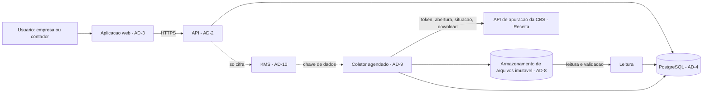

# Arquitetura do produto CreditoGov

Documento de decisão de arquitetura da demanda [031](../demandas/031-stack-arquitetura/us.md). Cada decisão tem um identificador estável **AD-N**. Uma decisão revista depois **não é apagada**: ganha uma linha no [histórico](#13-histórico-de-decisões) dizendo qual AD a substitui.

Fontes sobre a API de apuração da CBS: [`../referencias/apuracao-cbs/README.md`](../referencias/apuracao-cbs/README.md), citada por seção, observação (O-N) ou divergência (N), sempre com a data. O que não tem fonte está em [Perguntas em aberto e pendências](#12-perguntas-em-aberto-e-pendências), nunca afirmado como fato.

## 1. Objetivo e estado

**Objetivo.** Decidir, com base em fatos, a stack, a hospedagem, o banco, a separação dos dados por empresa, a coleta agendada, a guarda da credencial de cada cliente e o lugar da autenticação do CreditoGov, dentro do modelo SaaS multi-inquilino. Com isso, as demandas de login e de dashboard (033) não refazem a base depois.

**Estado.** Decidido em 2026-11-25, pelo responsável, ao aprovar a Spec da demanda 031 ("Aprovo todas"), com as recomendações das AD-1 a AD-14. Na AD-7, o tipo de hospedagem está escolhido e o provedor está pendente da PD-1.

**Nada foi construído.** Não há aplicação nova, conta em provedor, infraestrutura nem chamada à API da Receita. As aplicações [`app/apuracao-cbs`](../../app/apuracao-cbs) e [`app/painel`](../../app/painel) não mudam.

## 2. Premissas

Decididas pelo responsável em 2026-11-25, com as palavras dele quando existem:

- **SaaS multi-inquilino.** "tem que seguir o modelo de saas". Uma única instalação, operada pelo CreditoGov, atende todas as empresas clientes por assinatura. Não há instalação por cliente nem on-premise.
- **O acesso a cada CNPJ é decidido pela Receita, pela credencial do gov.br.** "essa responsabilidade é da receita, eu poderia por exemplo 'representar' o cnpj de qualquer empresa, mas o que vai valer são as credenciais do gov.br para aquele cnpj". O CreditoGov **não verifica** representação nem procuração: usa a credencial que recebe, e o que ela permite acessar é o que vale.
- **Cada cliente informa a própria credencial.** "Cada cliente cadastrado na plataforma vai precisar informar a sua." A base é o cenário A (uma credencial por CNPJ); o cenário B (credencial de procurador que cobre vários CNPJs) fica como contingência (AD-11).
- **Email e senha como base, sem bloquear login federado.** "Pode não entrar agora, mas teria muita credibilidade se usar logins federados (google e apple), e mais ainda se der para usar o login do gov.br". O login por email e senha (decisão de 2026-08-25) continua a base; a arquitetura não impede Google, Apple nem gov.br no futuro (AD-12).
- **ERP só como possível fonte de dados.** Integração com ERP não é o modelo, nem canal de distribuição, nem forma de login.
- **`app/painel` é ferramenta interna** de validação dos dados, não a primeira versão do produto para o usuário final. O dashboard do usuário é feito do zero (AD-14).

## 3. Visão geral

Dois fluxos independentes, ligados pelo banco e pelo armazenamento de arquivos. O coletor não depende da API do produto, e a API não depende do coletor (AD-2, AD-9).

Fluxo dos dados:

1. O usuário entra pela aplicação web, que só fala com a API. A web não acessa o banco (AD-3).
2. O cliente informa a credencial da Receita no cadastro; a API a cifra e grava, sem poder decifrá-la (AD-10).
3. O coletor, em processo próprio, abre consultas na API da Receita, acompanha a situação, baixa o arquivo e o guarda sem sobrescrever (AD-8, AD-9).
4. A leitura valida o arquivo e grava os dados lidos no banco, com a versão do leitor que os produziu (AD-8).
5. A API serve esses dados à web, isolados por empresa (AD-6).

Os componentes e as relações têm o modelo de dados conceitual na [AD-6](#ad-6--separação-dos-dados-por-empresa).

## 4. Decisões

Formato fixo de cada decisão: problema, critérios, alternativas com prós e contras, recomendação, escolha do responsável (com data), alternativas descartadas e fontes.

### AD-1 — Linguagem e runtime do backend

**Problema.** O produto precisa de uma API, de um coletor agendado e de leitura e validação dos arquivos da Receita.

**Critérios:** continuidade com o código existente; tipagem; bibliotecas de decimal exato e de JSON Schema 2020-12; equipe pequena; mesma linguagem na web.

| Alternativa | Prós | Contras |
|---|---|---|
| **A. Node 24 + TypeScript (ESM)** | As aplicações 029 e 030 já usam: leitura, validação (`ajv`, schemas oficiais), decimal (`big.js`), JSON sem perda (`lossless-json`), tolerância do `ni` e regras do emitente já escritas e testadas (`vitest`, `oxlint`). Mesma linguagem da landing e da aplicação web | Pede disciplina para não usar `number` em dinheiro (já resolvido na PoC) |
| B. Outra linguagem (Python, Go, Java, C#) | Ecossistemas maduros para backend | Reescrever o que 029 e 030 já provaram; duas linguagens no projeto |

**Recomendação:** A.

**Escolha do responsável:** A, Node 24 + TypeScript. Responsável, 2026-11-25 ("Aprovo todas").

**Descartada:** B, porque obrigaria a reescrever código já validado contra arquivos reais.

**Fontes:** [`PROJECT_CONTEXT.md`](../PROJECT_CONTEXT.md) §4 (o que existe em `app/apuracao-cbs` e `app/painel`); [`../referencias/apuracao-cbs/README.md`](../referencias/apuracao-cbs/README.md), O-1 a O-25 (arquivos reais lidos pelo código existente, 2026-11-24).

### AD-2 — Organização em aplicações e framework HTTP

**Problema.** Quantas aplicações novas e com qual framework a API é escrita.

**Critérios:** separar o processo da API do processo do coletor (o coletor não pode parar a API, e vice-versa); código de domínio compartilhado; validação de entrada; simplicidade.

**Organização recomendada:**

- `app/backend`: um pacote com dois pontos de entrada, `api` e `coletor`, que compartilham o código de domínio (leitura, validação, regras de crédito);
- `app/web`: a aplicação web (AD-3).

| Framework da API | Prós | Contras |
|---|---|---|
| Express (proposta da concepção) | O mais conhecido; muitas bibliotecas | Validação e tipagem por bibliotecas externas; tratamento de erro assíncrono depende da versão |
| **Fastify** | Validação de entrada e saída por JSON Schema, com `ajv`, a mesma biblioteca da PoC; tipagem TypeScript; plugins para cookie e sessão | Menos material que o Express |
| NestJS | Estrutura opinativa (módulos, injeção de dependência) | Camada a mais para uma equipe pequena; decorators |
| `node:http` puro (como o `app/painel`) | Zero dependência | Roteamento, validação, sessão e segurança escritos à mão |

**Recomendação:** organização em `app/backend` (api + coletor) e `app/web`, com Fastify na API.

**Escolha do responsável:** `app/backend` (api + coletor) e `app/web`, com Fastify na API. Responsável, 2026-11-25 ("Aprovo todas").

**Descartadas:**

- Express: a concepção não é especificação, e o Fastify já valida com o `ajv` que o projeto usa;
- NestJS: estrutura demais para o tamanho do time;
- `node:http` puro: segurança e sessão escritas à mão.

**Fontes:** [`PROJECT_CONTEXT.md`](../PROJECT_CONTEXT.md) §4 (proposta da concepção e o painel em `node:http`). A afirmação é sobre características gerais das bibliotecas; Fastify não foi usado no projeto (ver R-3 na [seção 12](#12-perguntas-em-aberto-e-pendências)).

### AD-3 — Aplicação web do produto

**Problema.** O framework e a forma de renderização do dashboard e das telas de cadastro. A demanda 033 aprovou a US do dashboard, com indicadores, estados e a carteira do contador (troca entre empresas). A biblioteca visual é da demanda 032.

**Critérios:**

- interação da carteira do contador (troca de empresa, filtros) sem recarregar tudo;
- não fixar biblioteca de componentes nem tokens, que são da 032;
- continuidade com a landing (React 19, Vite, TypeScript);
- hospedagem simples;
- a API como única porta dos dados.

| Alternativa | Prós | Contras |
|---|---|---|
| **A. React 19 + Vite + TypeScript, aplicação de página única consumindo a API** | Mesma base da landing; arquivos estáticos (hospedagem simples); separação limpa: a web não acessa o banco; deixa a 032 livre | Carga inicial maior que HTML do servidor; sem renderização no servidor (irrelevante numa área logada) |
| B. Next.js (React com renderização no servidor) | Renderização no servidor; rotas integradas | Um servidor Node a mais para operar; mistura camadas se acessar dados direto; mais acoplamento ao fornecedor do framework |
| C. HTML montado no servidor, sem JavaScript (como o `app/painel`) | Simples, seguro, já usado | Fraco para a carteira e os filtros do dashboard; não reaproveita a landing |
| D. React + Redux Toolkit + shadcn/ui (concepção) | Igual à A no framework | O estado do dashboard é quase todo dado vindo da API, o que não pede um estado global como o Redux; shadcn/ui é biblioteca visual e cabe à 032 |

**Recomendação:** A. Roteamento e busca de dados ficam para a Spec da implementação do dashboard, com um critério: estado vindo da API em cache por empresa, sem estado global. A biblioteca de componentes e a camada de estilo são da 032.

**Escolha do responsável:** A, React 19 + Vite + TypeScript, página única consumindo a API. Responsável, 2026-11-25 ("Aprovo todas").

**Descartadas:**

- B: um servidor a mais sem ganho numa área logada;
- C: não atende a interação da 033;
- D: Redux sem necessidade; shadcn/ui é decisão da 032.

**Fontes:** [`PROJECT_CONTEXT.md`](../PROJECT_CONTEXT.md) §4 (landing em React 19 e Vite; proposta da concepção); US da demanda 031, P-2 ([`us.md`](../demandas/031-stack-arquitetura/us.md)).

### AD-4 — Banco de dados

**Problema.** Onde ficam empresas, usuários, credenciais cifradas, consultas, metadados dos arquivos e dados lidos.

**Critérios:** decimal exato; isolamento por empresa no próprio banco; transações; migrações; serviço gerenciado nos provedores da AD-7.

| Alternativa | Prós | Contras |
|---|---|---|
| **A. PostgreSQL** | Tipo `numeric` exato; segurança por linha (row level security) para isolar empresas; `jsonb` se preciso; oferecido como serviço gerenciado pelos provedores da AD-7 | Exige cuidado com conexões em escala (pool) |
| B. MySQL | Também tem decimal exato e serviço gerenciado | Não tem segurança por linha nativa, então o isolamento fica só na aplicação |
| C. Banco de documentos (ex.: MongoDB) | Guarda o JSON da Receita como vem | Decimal e transações menos naturais; o JSON bruto já vai para o armazenamento de objetos (AD-8) |

**Recomendação:** A.

**Escolha do responsável:** A, PostgreSQL. Responsável, 2026-11-25 ("Aprovo todas").

**Descartadas:**

- B: perde a segunda barreira de isolamento (AD-6);
- C: o arquivo bruto não precisa estar no banco.

**Fontes:** características gerais dos bancos, sem preço. A ser confirmada com teste na primeira demanda de backend (R-3). Valores com 0 a 2 casas decimais no JSON da Receita: [`../referencias/apuracao-cbs/README.md`](../referencias/apuracao-cbs/README.md), O-13 (2026-11-24).

### AD-5 — Acesso a dados

**Problema.** Como o backend lê e escreve no PostgreSQL.

**Critérios:**

- `numeric` chega à aplicação como texto, nunca como `number`;
- funciona com a segurança por linha (fixar a empresa da transação antes das consultas);
- migrações versionadas;
- tipagem;
- SQL legível.

| Alternativa | Prós | Contras |
|---|---|---|
| TypeORM (proposta da concepção) | Conhecido; entidades com decorators | Decorators e entidades ativas escondem o SQL; fixar a empresa por transação junto com o gerenciamento de conexões dele exige cuidado |
| Prisma | Tipagem gerada; migrações | Decimal vem num tipo próprio, a converter para `big.js`; consultas fora do modelo dele ficam em SQL cru, o que também vale para fixar a empresa por transação |
| Drizzle | SQL tipado; `numeric` como texto; migrações | Projeto mais novo |
| **Kysely (construtor de consultas) + migrações dele** | SQL explícito e tipado; transação com comando de sessão simples; `numeric` como texto pelo driver `pg` | Sem modelo de entidades; os tipos do esquema são mantidos à mão ou gerados |

**Recomendação:** Kysely. Fica o SQL explícito, que combina com o isolamento por linha e com o decimal como texto.

**Escolha do responsável:** Kysely (segunda opção registrada: Drizzle). Responsável, 2026-11-25 ("Aprovo todas").

**Descartadas:**

- TypeORM: a concepção não é especificação, e o ORM esconde o SQL do isolamento;
- Prisma: conversão de decimal e SQL cru para o isolamento;
- Drizzle: alternativa aceitável, segunda opção.

**Fontes:** características gerais das bibliotecas, sem preço nem promessa de desempenho. Kysely não foi usado no projeto: a primeira demanda de backend confirma com teste o isolamento por linha e o `numeric` como texto (R-3).

### AD-6 — Separação dos dados por empresa

**Problema.** Dentro da operação única, como garantir que uma empresa nunca veja os dados de outra, sabendo que o contador vê várias.

**Critérios:** garantia mesmo com erro de programação; custo de operação com muitas empresas; migrações; consulta da carteira do contador (várias empresas numa tela).

| Alternativa | Prós | Contras |
|---|---|---|
| **A. Tabelas compartilhadas com o identificador da empresa + segurança por linha do PostgreSQL** | Uma migração para todos; a carteira consulta várias empresas numa consulta só; duas barreiras: a aplicação filtra, e o banco recusa o que não é da empresa fixada na transação | Toda tabela de dado de empresa precisa da regra de segurança, e os testes têm de provar o isolamento |
| B. Um schema por empresa | Isolamento visível | Migração repetida em cada schema; a carteira cruza schemas; o custo cresce com o número de empresas |
| C. Um banco por empresa | Isolamento máximo | Operação e custo proporcionais ao número de clientes; inviável para assinatura de PME |
| Fora do modelo: instalação por cliente, on-premise | — | **Descartada pela decisão de 2026-11-25** ("tem que seguir o modelo de saas") |

**Unidade de empresa:** a raiz do CNPJ (8 dígitos). Fonte: a API usa o CNPJ base na consulta, e um arquivo traz notas de vários estabelecimentos da mesma raiz ([`../referencias/apuracao-cbs/README.md`](../referencias/apuracao-cbs/README.md), O-24, 2026-11-24). "Vários CNPJs por cliente" (várias raízes num mesmo assinante, por exemplo um grupo) continua decisão em aberto em [`hipoteses.md`](../produto/hipoteses.md). O modelo abaixo aceita as duas respostas: o agrupamento seria uma entidade acima de `empresa`, sem mudar o isolamento.

**Contador:** um usuário com vínculos em várias empresas. A consulta da carteira fixa na transação o **conjunto** de empresas em que o usuário tem vínculo. Permissões por papel ficam para a demanda de login.

**Recomendação:** A, com o isolamento garantido na aplicação **e** no banco.

**Escolha do responsável:** A, tabelas compartilhadas com o identificador da empresa + segurança por linha do PostgreSQL. Responsável, 2026-11-25 ("Aprovo todas").

**Descartadas:**

- B e C: custo e operação crescem com cada cliente, e a carteira fica difícil;
- instalação por cliente e on-premise: fora do modelo SaaS (decisão de 2026-11-25).

**Fontes:** O-24 da referência, 2026-11-24; premissa de 2026-11-25 (seção 2); US da demanda 031 (CA-9 e CA-10).

#### Modelo de dados conceitual

São só as entidades e as relações que as decisões exigem, sem colunas nem migração: o esquema real é da primeira demanda de backend.

| Entidade | O que é | Relações |
|---|---|---|
| `empresa` | A unidade de inquilino: uma **raiz de CNPJ** (8 dígitos), como na API (`{cnpj}` base) e na O-24 | Tem estabelecimentos, que aparecem nos documentos; tem uma ou mais credenciais ao longo do tempo |
| `usuario` | Pessoa que entra no CreditoGov | N:N com `empresa`, por `vinculo_empresa` |
| `vinculo_empresa` | Liga usuário a empresa. O papel (titular, contador, outro) fica para a demanda de login | Um usuário com várias empresas (a carteira do contador); uma empresa com vários usuários |
| `identidade` | Forma de login de um usuário: email e senha hoje; Google, Apple ou gov.br depois (AD-12) | N:1 com `usuario` |
| `credencial_receita` | O par `client_id`/`client_secret` cifrado (AD-10), com o estado (ativa, inválida, substituída, removida) | **N:N com `empresa` por `credencial_empresa`**, restrito a 1:1 por regra no cenário A (AD-11) |
| `credencial_entrega` | Rastreio: quem informou, quando, para qual empresa e de que forma (titular ou procurador, **como declarado**, sem verificação) | Uma por entrega ou troca; imutável |
| `consulta` | Uma solicitação à API: serviço, empresa, credencial, tíquete, estado, horários e erro | Máquina de estados da AD-9 |
| `chamada_receita` | Cada chamada feita (token, abertura, situação, download, arquivo), com HTTP e horário, sem segredo | Base do orçamento do limite, como o `.local/chamadas.jsonl` da PoC |
| `arquivo_bruto` | Metadados do arquivo baixado (serviço, empresa, tíquete, `geradoEm`, hash, versão do schema, onde está) | O conteúdo fica no armazenamento de objetos (AD-8) |
| `leitura` | Dados lidos de cada arquivo (créditos, débitos e o resto), com a versão do leitor que os produziu | Reconstruível a partir dos `arquivo_bruto` (AD-8) |

Toda tabela com dado de empresa leva o identificador da empresa (AD-6).

### AD-7 — Hospedagem

**Problema.** Onde roda a operação única: API, coletor, web estática, banco, arquivos, chaves.

**Critérios:**

- custo (só com fonte);
- operação por equipe pequena;
- processo contínuo para o coletor (a espera de até 240 min é estado no banco, não processo preso, ver AD-9);
- serviço de chaves (KMS) para a credencial (AD-10);
- backup do banco e dos arquivos;
- região no Brasil.

A região no Brasil é critério de latência e de cuidado com dados. Se a lei exige ou não é pergunta para advogado (seção 8).

| Alternativa | Prós | Contras |
|---|---|---|
| **A. Nuvem grande com serviços gerenciados (AWS, Google Cloud ou Azure): contêineres gerenciados para API e coletor, PostgreSQL gerenciado, armazenamento de objetos, KMS e hospedagem estática da web** | KMS e armazenamento de objetos com bloqueio de sobrescrita no mesmo provedor; backup gerenciado; região no Brasil a confirmar na página de cada provedor | Mais conceitos para configurar; risco de custo sem limite, se não houver alerta de gasto |
| B. Plataforma como serviço simplificada (ex.: Render, Railway, Fly.io) | Deploy simples | KMS e região no Brasil não garantidos (a confirmar); a credencial pode exigir um segundo provedor só para chaves |
| C. Servidor virtual próprio com contêineres | Custo previsível | Backup, atualização, chaves e segurança ficam todos com a equipe |

**Custo estimado.** **Sem fonte.** Nenhuma página oficial de preço foi lida e citada com data nesta demanda, e nenhum valor entra sem ela. Cada linha abaixo fica "a confirmar (PD-1)" até alguém ler a página oficial de preço do provedor e registrar o endereço e a data da leitura.

| Provedor | Contêineres (API e coletor) | PostgreSQL gerenciado | Armazenamento de objetos | KMS | Região no Brasil | Fonte e data |
|---|---|---|---|---|---|---|
| AWS | a confirmar (PD-1) | a confirmar (PD-1) | a confirmar (PD-1) | a confirmar (PD-1) | a confirmar (PD-1) | sem página lida |
| Google Cloud | a confirmar (PD-1) | a confirmar (PD-1) | a confirmar (PD-1) | a confirmar (PD-1) | a confirmar (PD-1) | sem página lida |
| Azure | a confirmar (PD-1) | a confirmar (PD-1) | a confirmar (PD-1) | a confirmar (PD-1) | a confirmar (PD-1) | sem página lida |

**Recomendação:** A. O tipo (nuvem gerenciada) se decide pelos critérios não financeiros. O provedor (AWS, Google Cloud ou Azure) sai da tabela de custo com fonte (PD-1). Não há preferência técnica forte entre os três para o que esta arquitetura usa.

**Escolha do responsável:** tipo A, nuvem grande com serviços gerenciados; provedor (AWS, Google Cloud ou Azure) pendente da PD-1. Responsável, 2026-11-25 ("Aprovo todas").

**Descartadas:**

- B: guarda de chaves e região incertas;
- C: operação demais para a equipe;
- instalação por cliente e on-premise: fora do modelo SaaS (2026-11-25).

**Fontes:** o limite de 240 min de processamento vem da [referência](../referencias/apuracao-cbs/README.md), seção "Fluxo de uma consulta" (lida em 2026-11-24). Preço: nenhuma fonte (PD-1, na [seção 12](#12-perguntas-em-aberto-e-pendências)). A primeira demanda de backend roda local e não depende desta escolha (R-4).

### AD-8 — Guarda do arquivo bruto e reconstrução

**Problema.** A API não devolve histórico: cada chamada traz só o que mudou nos últimos 8 dias, e o que não for coletado a tempo se perde (referência, seção "Consulta incremental"). O arquivo perdido não volta. A regra de leitura vai mudar: o schema já diverge do arquivo real (divergência 10 da referência, confirmada em 2026-11-24), e as hipóteses D-2 a D-6 de [`hipoteses.md`](../produto/hipoteses.md) estão abertas.

**Critérios:** imutável; com backup; reprocessável; separado por empresa.

| Alternativa | Prós | Contras |
|---|---|---|
| **A. Armazenamento de objetos com sobrescrita bloqueada e versionamento; metadados e hash em `arquivo_bruto`** | Barato para arquivos grandes (o limite de leitura do painel é 200 MB; o maior arquivo real observado tem menos de 1 MB, demanda 030); imutável por configuração; backup por replicação | Dois lugares a manter coerentes (objeto e linha) |
| B. Arquivo dentro do PostgreSQL (`jsonb` ou binário) | Uma só cópia de segurança | Banco cresce com arquivos grandes; `jsonb` perde a forma original dos números |
| C. Disco do servidor (como a PoC em `.local/`) | Simples | Perde-se com o servidor; sem replicação |

**Reconstrução.** Cada linha de `leitura` guarda a versão do leitor. Quando a regra muda (schema novo, tolerância nova, D-5 confirmada), um comando relê os `arquivo_bruto` da empresa e regrava `leitura`, sem chamar a API. O arquivo é guardado **antes** de ser validado, como na PoC: arquivo recusado também fica.

**Recomendação:** A.

**Escolha do responsável:** A, armazenamento de objetos imutável + metadados em `arquivo_bruto`. Responsável, 2026-11-25 ("Aprovo todas").

**Descartadas:**

- B: o tamanho dos arquivos e a perda da forma original dos números;
- C: o arquivo se perde junto com o servidor.

**Fontes:** [referência](../referencias/apuracao-cbs/README.md), seção "Consulta incremental" e divergência 10 (2026-11-24); números com 0 a 2 casas no JSON, O-13; hipóteses D-2 a D-6 em [`hipoteses.md`](../produto/hipoteses.md).

### AD-9 — Coletor agendado

**Problema.** Consultar cada serviço de cada empresa a tempo (janela de 8 dias), dentro dos limites, aguentando até 240 min de processamento, com 48 h para baixar o arquivo e sem gastar chamada à toa. O desenho completo (ciclo, orçamento, falhas e alertas) está na [seção 5](#5-coleta-agendada).

**Critérios:** sobreviver a reinício; contar cada chamada; nunca repetir abertura sem decisão explícita; simplicidade.

| Alternativa | Prós | Contras |
|---|---|---|
| **A. Processo coletor contínuo, com fila e máquina de estados no PostgreSQL** | Estado sobrevive a reinício; a contagem do limite fica na mesma transação do estado; nenhum serviço a mais | O coletor é um processo sempre ligado |
| B. Agendador + funções sob demanda (serverless), estado no banco | Paga só pelo uso | Cada passo vira uma função, o que traz mais peças e mais acoplamento ao provedor |
| C. Fila gerenciada do provedor | Retentativas prontas | Retentativa automática pode gastar chamada do limite sem querer; estado em dois lugares |

**Recomendação:** A, com o desenho da seção 5.

**Escolha do responsável:** A, processo coletor contínuo com fila e máquina de estados no PostgreSQL. Responsável, 2026-11-25 ("Aprovo todas").

**Descartadas:**

- B: peças demais e acoplamento ao provedor;
- C: retentativa automática pode gastar o limite da Receita.

**Fontes:** [referência](../referencias/apuracao-cbs/README.md): seção "Fluxo de uma consulta" (240 min, 48 h, aviso sem autenticação), "Consulta incremental" (8 dias), "Limite de uso", divergências 1, 5, 6 e 9, "Observado na chamada real (2026-11-24)"; manual Receita Integra v1.4 (17/07/2026) para o token; notícia oficial de 09/11/2026 para os serviços novos.

<!-- AD-NEXT -->

## 5. Coleta agendada

Detalha a [AD-9](#ad-9--coletor-agendado). Fontes: [referência](../referencias/apuracao-cbs/README.md). Os comportamentos observados valem para um dia e uma empresa (2026-11-24): a referência manda conferir de novo antes de depender deles, e o documento manda reconferir a referência antes de cada demanda de coletor (R-2).

### Ciclo de uma consulta

Estados de `consulta`: `agendada` → `aberta` (com tíquete) → `concluida` → `baixada` → `lida`. Os estados finais de erro são `erro`, `expirada`, `credencial_invalida` e `servico_indisponivel`.

- **Tíquete.** É gravado **na mesma transação** que registra a chamada de abertura, antes de qualquer outro passo. É a mesma regra da PoC: o tíquete vale uma abertura do limite (seção "Limite de uso").
- **Espera.** Só por consulta de situação, com `urlRetorno` vazio, que foi aceito na chamada real (HTTP 201 em créditos e débitos; divergência 6; "Observado na chamada real", 2026-11-24). Intervalo mínimo de 5 minutos entre consultas de situação, o padrão da PoC. Depois de 240 min sem conclusão, a consulta vira `expirada` (seção "Fluxo de uma consulta"; divergência 5: guia e FAQ falam em "status de erro", a página de situação mostra `EXPIRADA`, e os dois são tratados como fim).
- **Por que não o aviso (`urlRetorno`).** Exige endereço público nosso e não tem assinatura nem autenticação (seção "Fluxo de uma consulta"). Se um dia for adotado, vale só como sinal para consultar a situação antes do horário, nunca como resultado.
- **Download.** Logo depois de `CONCLUIDA`, bem antes das 48 h (seção "Fluxo de uma consulta"; a divergência 7 registra 24 h no manual da Plataforma da CBS v1, que não vale onde diverge da v2). Se falhar, nova URL assinada pelo mesmo tíquete, sem nova abertura.
- **Reinício.** Ao subir, o coletor retoma as consultas `aberta` e `concluida` pelo tíquete gravado. A espera é estado no banco, não processo preso.

### Frequência e orçamento

Por empresa, por serviço, por credencial:

- **Uma abertura por dia** em cada serviço disponível (créditos e débitos), o que usa **1 das 4 chamadas** (limite por API e por credencial; "por dia" só na FAQ, divergência 1, não testada). Sobram 3 para casos decididos.
- A cadência diária deixa **7 dias de folga** dentro da janela de 8 (seção "Consulta incremental": consultar pelo menos uma vez a cada 8 dias, por serviço e por cliente).
- **Não reabrir no mesmo dia** depois de uma consulta concluída: a segunda abertura de créditos feita cerca de 2 min depois da primeira concluída respondeu HTTP 400, sem motivo conhecido ("Observado na chamada real", 2026-11-24; a divergência 1 registra a mesma observação).
- **Horários** espalhados ao longo do dia e longe da meia-noite, porque a FAQ diz que a cota reinicia à meia-noite e não diz o fuso (divergência 1; pergunta em aberto).
- **Token.** Um por ciclo da credencial, reaproveitado por 1 hora para os serviços daquela credencial, guardado cifrado (AD-10), dentro do limite de 2 por hora. Validade de 1 hora e limite de 2 por hora: manual Receita Integra v1.4 (17/07/2026), seção "O que não está documentado" da referência. O controle local conta os pedidos, como na PoC.
- **Situação e download** também ficam registrados em `chamada_receita`, porque não se sabe se contam no limite ("Observado na chamada real": nenhum HTTP 429 em 1 token, 5 aberturas, 2 situações e 2 downloads; não dá para dizer se situação e download contam, nem se abertura recusada conta).

### Falhas

Nenhuma retentativa é automática quando gasta abertura, salvo onde a tabela diz.

| Situação | Tratamento | Fonte |
|---|---|---|
| HTTP 429 | Para o serviço daquela credencial até o dia seguinte; registra o ocorrido | Limite de 4 chamadas, seção "Limite de uso"; o 429 não foi observado (divergência 1) |
| HTTP 400 na abertura, sem motivo conhecido | Não repete no dia; tenta no ciclo seguinte; no segundo dia seguido, vira alerta para a operação | "Observado na chamada real" (2026-11-24); a mensagem de erro não foi registrada |
| HTTP 404 na abertura (recolhimentos e pagamentos) | `servico_indisponivel`. Tenta uma vez por dia, porque a notícia de 09/11/2026 fala em serviços novos ainda em novembro. Se o 404 conta no limite não se sabe; 1 de 4 por dia é aceitável | Divergência 9 e O-17 (2026-11-24); notícia oficial de 09/11/2026, seção "Ambientes e novidades" |
| Situação `ERRO` ou `EXPIRADA` | Uma nova abertura no mesmo dia, se o orçamento tiver sobra (até 2 por dia por serviço, deixando 2 de reserva). Senão, no ciclo seguinte | Divergência 5; não testada |
| Recusa da credencial no token, ou "consumidor não autorizado para este NI" | Descarta o token. Uma única nova tentativa com token novo. Se repetir, a credencial vira `credencial_invalida`, a coleta da empresa para e um alerta vai para os usuários dela (AD-10). A PoC trata o HTTP 401 da abertura como token recusado ou consumidor não autorizado: é interpretação da PoC, e o código exato desse erro não tem fonte | Seção "O que não está documentado" (erro "consumidor não autorizado para este NI") |
| Sem resposta (rede, tempo esgotado) na abertura | Fica `aberta_sem_tiquete`, tratada como chamada gasta. Não repete no dia | Decisão de arquitetura, para não gastar o limite; sem fonte sobre como a Receita conta a abertura sem resposta |
| Falha no download | Nova URL assinada pelo mesmo tíquete, até as 48 h | Seção "Fluxo de uma consulta" |

### Alertas

Para cada empresa e serviço disponível, o banco guarda a data da última consulta `lida`. A perda de dados ocorre quando passam mais de 8 dias sem coleta (seção "Consulta incremental").

| Dias sem coleta lida | Quem é avisado |
|---|---|
| 2 dias | Equipe do CreditoGov |
| 3 dias, e o problema depende do cliente (credencial inválida ou ausente) | Também os usuários com vínculo na empresa, inclusive o contador |
| 5 dias | Alerta crítico para a equipe, faltando 3 para a perda de dados |

O canal (email ou outro) e o texto ficam para a demanda que implementar o coletor.

## 6. Credencial da Receita

<!-- TASK-5 -->

## 7. Cenários de acesso

<!-- TASK-5B -->

## 8. Dados sensíveis e proteção

<!-- TASK-7A -->

## 9. Ambientes, testes e configuração

<!-- TASK-7B -->

## 10. O que a arquitetura não bloqueia

<!-- TASK-7C -->

## 11. Decidido aqui / fica para

<!-- TASK-7D -->

## 12. Perguntas em aberto e pendências

<!-- TASK-7E -->

## 13. Histórico de decisões

| Data | AD | Mudança |
|---|---|---|
| 2026-11-25 | AD-1 a AD-14 | Decididas pelo responsável ao aprovar a Spec da demanda 031, com as recomendações; na AD-7, provedor pendente da PD-1. Nada construído |
