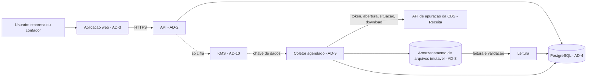

# Arquitetura do produto CreditoGov

Documento de decisão de arquitetura da demanda [031](../demandas/031-stack-arquitetura/us.md). Cada decisão tem um identificador estável **AD-N**. Uma decisão revista depois **não é apagada**: ganha uma linha no [histórico](#13-histórico-de-decisões) dizendo qual AD a substitui.

Fontes sobre a API de apuração da CBS: [`../referencias/apuracao-cbs/README.md`](../referencias/apuracao-cbs/README.md), citada por seção, observação (O-N) ou divergência (N), sempre com a data. O que não tem fonte está em [Perguntas em aberto e pendências](#12-perguntas-em-aberto-e-pendências), nunca afirmado como fato.

## 1. Objetivo e estado

**Objetivo.** Decidir, com base em fatos, a stack, a hospedagem, o banco, a separação dos dados por empresa, a coleta agendada, a guarda da credencial de cada cliente e o lugar da autenticação do CreditoGov, dentro do modelo SaaS multi-inquilino. Com isso, as demandas de login e de dashboard (033) não refazem a base depois.

**Estado.** Decidido em 2026-11-25, pelo responsável, ao aprovar a Spec da demanda 031 ("Aprovo todas"), com as recomendações das AD-1 a AD-14. Na AD-7, o tipo de hospedagem está escolhido e o provedor está pendente da PD-1.

**Nada foi construído.** Não há aplicação nova, conta em provedor, infraestrutura nem chamada à API da Receita. As aplicações [`app/apuracao-cbs`](../../app/apuracao-cbs) e [`app/painel`](../../app/painel) não mudam.

## 2. Premissas

Decididas pelo responsável em 2026-11-25, com as palavras dele quando existem:

- **SaaS multi-inquilino.** "tem que seguir o modelo de saas". Uma única instalação, operada pelo CreditoGov, atende todas as empresas clientes por assinatura. Não há instalação por cliente nem on-premise.
- **O acesso a cada CNPJ é decidido pela Receita, pela credencial do gov.br.** "essa responsabilidade é da receita, eu poderia por exemplo 'representar' o cnpj de qualquer empresa, mas o que vai valer são as credenciais do gov.br para aquele cnpj". O CreditoGov **não verifica** representação nem procuração: usa a credencial que recebe, e o que ela permite acessar é o que vale.
- **Cada cliente informa a própria credencial.** "Cada cliente cadastrado na plataforma vai precisar informar a sua." A base é o cenário A (uma credencial por CNPJ); o cenário B (credencial de procurador que cobre vários CNPJs) fica como contingência (AD-11).
- **Email e senha como base, sem bloquear login federado.** "Pode não entrar agora, mas teria muita credibilidade se usar logins federados (google e apple), e mais ainda se der para usar o login do gov.br". O login por email e senha (decisão de 2026-08-25) continua a base; a arquitetura não impede Google, Apple nem gov.br no futuro (AD-12).
- **ERP só como possível fonte de dados.** Integração com ERP não é o modelo, nem canal de distribuição, nem forma de login.
- **`app/painel` é ferramenta interna** de validação dos dados, não a primeira versão do produto para o usuário final. O dashboard do usuário é feito do zero (AD-14).

## 3. Visão geral

Dois fluxos independentes, ligados pelo banco e pelo armazenamento de arquivos. O coletor não depende da API do produto, e a API não depende do coletor (AD-2, AD-9).

Fluxo dos dados:

1. O usuário entra pela aplicação web, que só fala com a API. A web não acessa o banco (AD-3).
2. O cliente informa a credencial da Receita no cadastro; a API a cifra e grava, sem poder decifrá-la (AD-10).
3. O coletor, em processo próprio, abre consultas na API da Receita, acompanha a situação, baixa o arquivo e o guarda sem sobrescrever (AD-8, AD-9).
4. A leitura valida o arquivo e grava os dados lidos no banco, com a versão do leitor que os produziu (AD-8).
5. A API serve esses dados à web, isolados por empresa (AD-6).

Os componentes e as relações têm o modelo de dados conceitual na [AD-6](#ad-6--separação-dos-dados-por-empresa).

## 4. Decisões

<!-- TASK-2 -->

## 5. Coleta agendada

<!-- TASK-4 -->

## 6. Credencial da Receita

<!-- TASK-5 -->

## 7. Cenários de acesso

<!-- TASK-5B -->

## 8. Dados sensíveis e proteção

<!-- TASK-7A -->

## 9. Ambientes, testes e configuração

<!-- TASK-7B -->

## 10. O que a arquitetura não bloqueia

<!-- TASK-7C -->

## 11. Decidido aqui / fica para

<!-- TASK-7D -->

## 12. Perguntas em aberto e pendências

<!-- TASK-7E -->

## 13. Histórico de decisões

| Data | AD | Mudança |
|---|---|---|
| 2026-11-25 | AD-1 a AD-14 | Decididas pelo responsável ao aprovar a Spec da demanda 031, com as recomendações; na AD-7, provedor pendente da PD-1. Nada construído |
